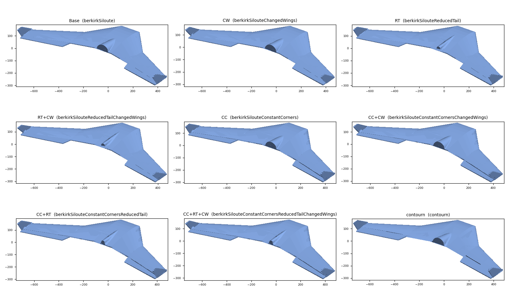
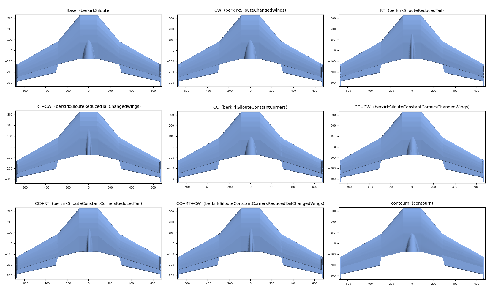
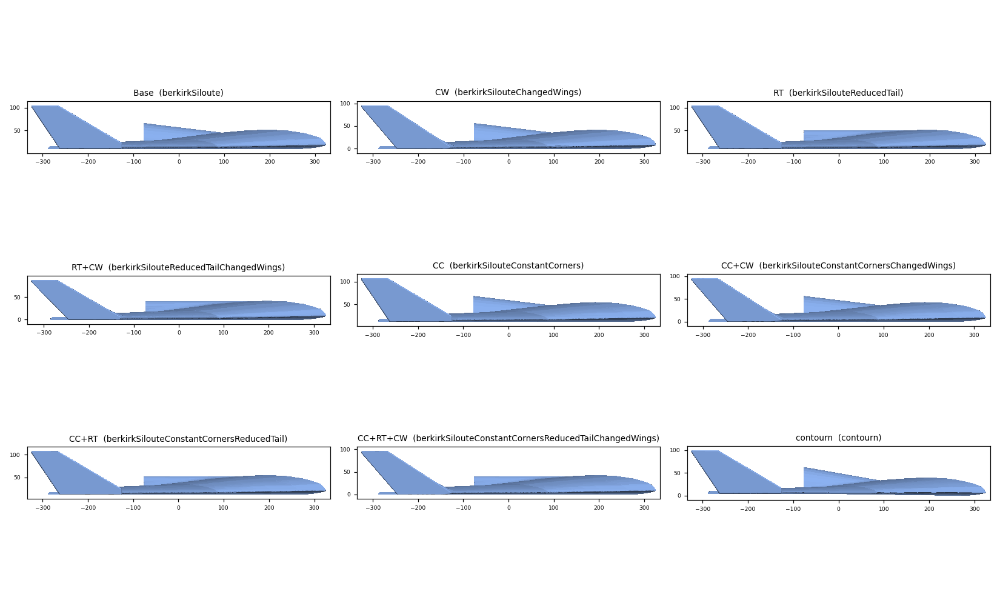
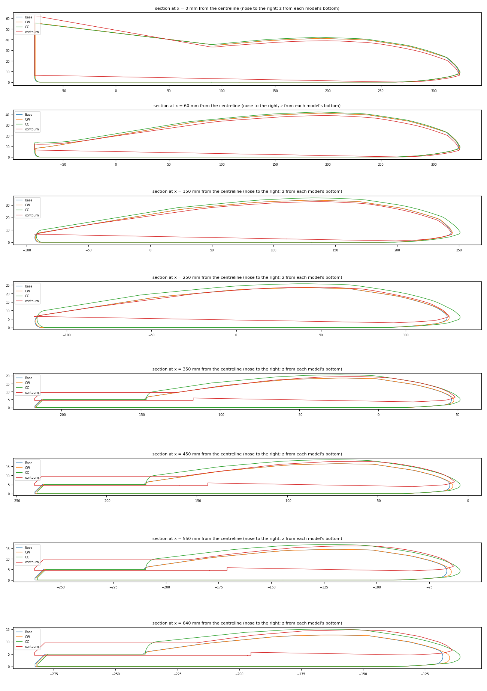
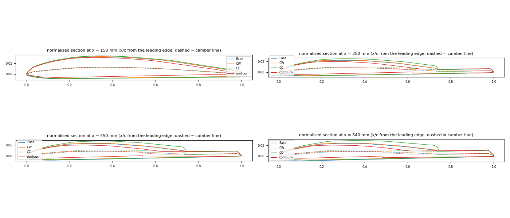
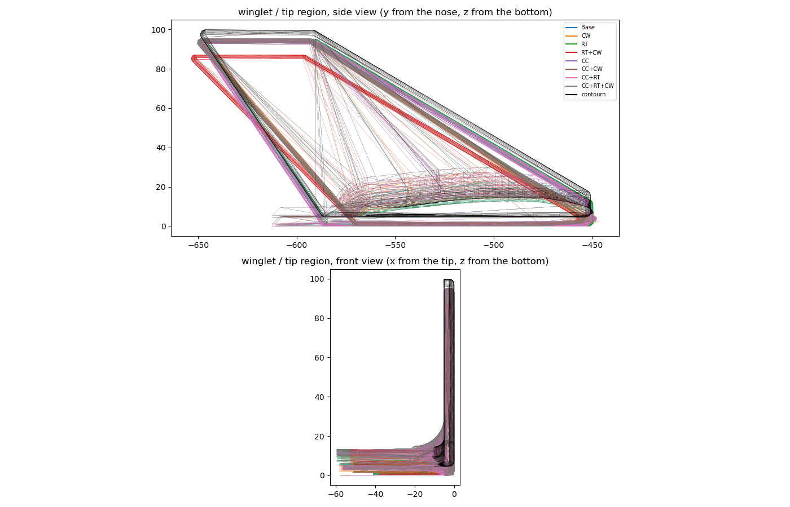

# Berkirk 3 redesign: aerodynamic evaluation report and test plan

| | |
|---|---|
| Date | 2026-10-13, updated 2026-10-15 |
| Status | Elevon joint fixed and all files re-exported (commit `1a596ae`), checked on 2026-10-15 (§4.7): one fused body per model, all 9 STLs clean, CC and `contourn` STEPs valid. Script fixes (§4.8): all 9 STEPs repaired and moved to the common datum in `STP/fixed/`, and watertight fine CFD STLs in `STL/cfd/`. **No aerodynamic test has been run yet.** |
| Next action | Designer: decide on the RT+CW winglet and give the motor and mass data. Optional: repair the inboard upper-surface face of the 4 non-CC models in Inventor (§4.7). Claude: then Step 3, using `STP/fixed/` and `STL/cfd/`. |
| Re-run the measurements | `python3 analysis/scripts/stl_geometry.py`; STEP check: copy `analysis/scripts/step_check.py` to `~/snap/freecad/common/` and run `freecad.cmd ~/snap/freecad/common/step_check.py $PWD/STP`. Rebuild `STP/fixed/` + `STL/cfd/`: same with `step_fix_align.py $PWD`, then `python3 analysis/scripts/stl_close_holes.py STL/cfd/*.stl` |

---

## 1. Summary

- **Goal:** compare the aerodynamics of the 9 Inventor models of the Berkirk 3 flying wing, pick one, keep designing it and build it.
- **The STL files are clean:** binary, in mm, one closed watertight body each, correct normals. They can go straight into OpenFOAM's mesher (snappyHexMesh). The low-order aero tools need STEP files or airfoil + planform data instead (Step 1).
- **All 9 models share the same planform:**
  - With elevons (2026-10-15): span 1.336 m (1.346 m for ConstantCorners), projected area ≈ 0.358–0.365 m², mean aerodynamic chord (MAC) ≈ 289–292 mm, aspect ratio ≈ 5.0.
  - The first inspection, without elevons, gave ≈ 0.32 m², MAC ≈ 276 mm and AR ≈ 5.6.
- **The variants differ in details that need 3D/viscous analysis:**
  - edge rounding and thickness (ConstantCorners)
  - size of the motor cowl's flat rear face (ReducedTail)
  - winglet and tip shape (ChangedWings)
  - a different, thinner airfoil (contourn)

  Vortex-lattice and panel methods will barely separate the variants. Use them for stability and trim, and rank the variants with CFD and physical tests.
- **Fix these before any test** (status after the 2026-10-15 re-export, details in §4.6):
  1. ~~The elevons are missing from all models.~~ **Done.** All 9 models now have 5 mm flat-plate elevons fixed at 0°. Wing area is now 35.8–36.5 dm², against the original's 36.54 dm².
  2. ReducedTail+ChangedWings has **87 mm winglets**; all the other models have 95 mm. **Still open.**
  3. **Common datum:**
     - **Mostly done in the STEP files:** root leading edge at y ≈ 199–201 mm, bottom at z = 0.
     - **Not done in 8 of the 9 STLs** (all except Base).
  4. **New:** the 8 Siloute STEP solids are **invalid** where the elevon meets the rounded trailing edge, and the `contourn` STL is badly tessellated. Both need fixing before Flow5/CFD.
- **Biggest aerodynamic risk: pitch trim.**
  - No airfoil has reflex, and washout is ≤ 1°.
  - The original Berkik 3 trims with a fixed elevon reflex (template T1, 166°).
  - So trim must be analysed first, and the CFD must be run with the elevons at their trim angle.

### Which method can see which difference

| Difference between the variants | Low-order (Flow5 / XFLR5 / AVL / VSPAERO) | RANS CFD (OpenFOAM) | Flight / wind tunnel |
|---|---|---|---|
| Twist and camber (CW, CC, contourn) | yes | yes | yes |
| Thickness and edge rounding (CC, contourn) | partly, through XFoil airfoil polars | yes | yes |
| Motor-cowl rear face (RT) | no | yes (overstated without the propeller) | yes |
| Blunt trailing edges, base drag | no | yes | yes |
| Winglet shape (CW) | yes, as lifting surfaces | yes | yes |
| Neutral point, trim, stability modes | yes, fast | possible but slow | yes |

---

## 2. Reference data: the original Berkik 3

From `PDFs/plano.pdf` (designed by Julius Perdana, 2021, paper-replika.com):

| Item | Value |
|---|---|
| Wingspan | 1300 mm |
| Flying weight | 700 g |
| Wing area | 36.54 dm² |
| Wing loading | 19.2 g/dm² (wing cube loading 3.2) |
| CG | 26 cm behind the leading edge, "right on the wing break" |
| Power | Turnigy 2826 2200 kV, 3S 2200 mAh, 5×5×3 pusher prop (5–9 in props possible), 2 × 9 g servos. **The redesign uses an A2212/10T 1400 kV motor instead** (decided 2026-10-14). |
| Structure | 5 mm foamboard/Depron, 3 mm plywood motor mount (M1–M3), 0.3 mm plastic motor cowl (M4) |
| Controls | Separate elevons (W16, 5 mm foam) set with an "elevon reflex" template (T1, 166°); winglets (W17) |

Use these as the sanity check for the redesign: weight target, CG position and trim.

---

## 3. The 9 models

| File in `STL/` | Short name | ConstantCorners | ReducedTail | ChangedWings |
|---|---|:---:|:---:|:---:|
| `berkirkSiloute.stl` | Base | | | |
| `berkirkSilouteChangedWings.stl` | CW | | | x |
| `berkirkSilouteReducedTail.stl` | RT | | x | |
| `berkirkSilouteReducedTailChangedWings.stl` | RT+CW | | x | x |
| `berkirkSilouteConstantCorners.stl` | CC | x | | |
| `berkirkSilouteConstantCornersChangedWings.stl` | CC+CW | x | | x |
| `berkirkSilouteConstantCornersReducedTail.stl` | CC+RT | x | x | |
| `berkirkSilouteConstantCornersReducedTailChangedWings.stl` | CC+RT+CW | x | x | x |
| `contourn.stl` | contourn | separate design (thin airfoil, sharp trailing edge) | | |

The 8 "Siloute" models cover every combination of three changes (a 2×2×2 factorial set). Comparing matched pairs gives the effect of each change on its own (Step 5).





---

## 4. Inspection results

> **§4.1–4.5 describe the first inspection (2026-10-13, STLs without elevons).** Their tables are kept for reference. The re-export with elevons is checked in **§4.6**, which supersedes them where they differ.

### 4.1 File format and mesh health

- Binary STL written by Inventor (header `STLB ATF 14.31.1.0`), units **mm**.
- Axes: **X = span** (right wing +X), **Y = forward** (nose at +Y), **Z = up**.

| Model | Triangles | Shells | Open edges | Non-manifold | Flipped | Degenerate | Normals OK | Slivers | Max edge [mm] | Facet angle p90 / p99 [deg] |
|---|---|---|---|---|---|---|---|---|---|---|
| Base | 21836 | 1 | 0 | 0 | 0 | 0 | 100% | 53% | 559 | 10.2 / 21.4 |
| CW | 23052 | 1 | 0 | 0 | 0 | 0 | 100% | 64% | 559 | 10.0 / 19.7 |
| RT | 21866 | 1 | 0 | 0 | 0 | 0 | 100% | 53% | 559 | 10.3 / 21.2 |
| RT+CW | 21282 | 1 | 0 | 0 | 0 | 0 | 100% | 59% | 559 | 10.3 / 22.7 |
| CC | 36878 | 1 | 0 | 0 | 0 | 0 | 100% | 33% | 527 | 8.9 / 15.1 |
| CC+CW | 34564 | 1 | 0 | 0 | 0 | 0 | 100% | 37% | 553 | 8.9 / 15.1 |
| CC+RT | 36964 | 1 | 0 | 0 | 0 | 0 | 100% | 33% | 527 | 8.9 / 15.1 |
| CC+RT+CW | 34690 | 1 | 0 | 0 | 0 | 0 | 100% | 37% | 553 | 8.9 / 15.1 |
| contourn | 9202 | 1 | 0 | 0 | 0 | 0 | 100% | 39% | 385 | 10.8 / 79.4 |

*Slivers* are triangles with quality < 0.1 (long and thin). *Facet angle* is the angle between the normals of neighbouring triangles.

**How to read this:**
- Every model is a valid closed solid, so the files are fine for snappyHexMesh and for 3D printing.
- The tessellation is coarse. On rounded edges, neighbouring facets jump ~10–20°, and a third to two-thirds of the triangles are slivers up to 0.56 m long.
- snappyHexMesh tolerates this, but codes that use the triangles directly as panels don't, and a faceted leading edge matters in low-Reynolds CFD.
- So re-export finer meshes for CFD (Step 1).

### 4.2 Shared geometry and reference values

Planform (the same in all models within ±5 mm):

| Station | Spanwise position x | Leading edge behind the nose | Chord |
|---|---|---|---|
| Centre section (straight, unswept front) | 0–80 mm | 0 mm | 400 mm |
| Kink ("wing break") | ≈ 290 mm | 239–244 mm | 209–213 mm |
| Tip (just inboard of the winglet) | ≈ 655 mm | 444–450 mm | 118–124 mm |
| Winglet (vertical, at x ≈ 663–668 mm) | | | ≈ 135 mm at the root, ≈ 55 mm at the top, 95 mm tall |

- **Sweep:**
  - Leading edge: ≈ 50° on the inner panel, ≈ 29° on the outer panel.
  - Trailing edge: ≈ 14° on the inner panel, ≈ 17.5° on the outer panel.
  - The centre trailing edge is straight, ≈ 400 mm behind the nose.
- **Reference values without elevons (Base):**
  - S = 0.316 m², b = 1.336 m, AR = 5.66.
  - MAC = 275.5 mm, located 256 mm from the centreline.
  - MAC leading edge 175 mm behind the nose; 25% MAC point 244 mm behind the nose.
  - Recompute all of these after adding the elevons.
- **Airfoils of the 8 Siloute models:**
  - Shape: flat bottom, rounded leading edge, rounded blunt trailing edge 6–10 mm thick.
  - Thickness-to-chord (t/c) ≈ 9.5–12%, with maximum thickness at 33–45% chord.
  - Camber ≈ 2.2–3.3%.
  - **No reflex:** the camber line descends towards the trailing edge at every station.
  - Washout ≤ 1°.
- The original's flight-tested CG (260 mm, "on the wing break") compares with the leading-edge kink in your models, which is 239–244 mm behind the nose.

### 4.3 What each variant changes

| Model | S [dm²] | b [mm] | Wetted area [dm²] | Volume [L] | Frontal area [cm²] | Flat rear area at centre [cm²] | Winglet height [mm] | TE thickness at x = 250 / 450 / 640 [mm] | Washout x = 150 → 640 [deg] |
|---|---|---|---|---|---|---|---|---|---|
| Base | 31.56 | 1336 | 69.36 | 6.77 | 331 | 48.7 | 95 | 7.8 / 6.9 / 6.2 | 0.26 |
| CW | 31.70 | 1336 | 68.99 | 6.76 | 332 | 48.7 | 95 | 7.8 / 6.9 / 6.2 | 0.46 |
| RT | 31.56 | 1336 | 69.01 | 6.60 | 324 | 17.1 | 95 | 7.8 / 6.9 / 6.2 | 0.26 |
| RT+CW | 31.55 | 1336 | 68.15 | 6.58 | 324 | 17.1 | **87** | 7.8 / 6.9 / 6.2 | 0.25 |
| CC | 32.27 | 1346 | 70.88 | 7.43 | 359 | 48.3 | 95 | 10.5 / 10.1 / 9.7 | 1.03 |
| CC+CW | 32.28 | 1346 | 70.36 | 7.42 | 359 | 48.3 | 95 | 10.5 / 10.1 / 9.7 | 1.00 |
| CC+RT | 32.27 | 1346 | 70.53 | 7.26 | 352 | 17.9 | 95 | 10.5 / 10.1 / 9.7 | 1.03 |
| CC+RT+CW | 32.28 | 1346 | 70.01 | 7.25 | 353 | 17.9 | 95 | 10.5 / 10.1 / 9.7 | 1.00 |
| contourn | 31.86 | 1336 | 69.42 | 5.51 | 307 | 50.0 | 95 | 1.3 / 0.8 / 0.6 | 0.03 |

- *Flat rear area* is the aft-facing area near the centreline: the motor-cowl face plus the blunt centre trailing edge. The motor face alone measures:
  - ≈ 110 mm wide × 56 mm tall in Base and CC
  - ≈ 41 × 40 mm in RT and CC+RT
  - ≈ 117 × 62 mm in contourn
- *TE thickness* is measured 3% of the chord ahead of the trailing edge.

What each change does:

| Change | Measured effect |
|---|---|
| **ReducedTail** | Motor-cowl rear face 49 → 17 cm² (≈ 110 × 56 mm → ≈ 41 × 40 mm). Volume −0.17 L. Nothing else changes. |
| **ConstantCorners** | Rounder, thicker edges: trailing edge ≈ 10 mm instead of 6–8 mm. Outer-wing t/c ≈ 11–12% instead of ≈ 10%, with maximum thickness moved aft. Washout ≈ 1.0° instead of ≈ 0.3°. Span +10 mm, volume +0.66 L, wetted area +1.5 dm², frontal area +8%. |
| **ChangedWings** | Mainly the winglet and tip shape (see `figures/winglets.png`). Base → CW also adds 0.2° of washout and slightly more outboard camber. **It is not the same change in every combination:** RT+CW has 87 mm winglets that sit ≈ 3 mm further aft. |
| **contourn** | Different airfoil: thinner (≈ 7.7% outboard), sharp trailing edge, no twist, and a sharp winglet junction with no fillet. Smallest volume (5.5 L) and frontal area; largest motor face. Probably your model of the original Berkik 3 (to be confirmed). |

### 4.4 Airfoil sections

Section properties at four spanwise stations (x = distance from the centreline). RT, RT+CW, CC+RT and CC+RT+CW have the same outboard sections as Base or CC. The full table is printed by the script.

| Model | x [mm] | Chord [mm] | Incidence [deg] | t/c [%] @ x/c | Camber [%] @ x/c | TE thickness [mm] |
|---|---|---|---|---|---|---|
| Base | 150 | 337.3 | 0.78 | 10.1 @ 0.34 | 3.01 @ 0.34 | 8.7 |
| Base | 350 | 194.3 | 0.54 | 9.5 @ 0.35 | 2.45 @ 0.37 | 7.2 |
| Base | 550 | 144.6 | 0.50 | 10.0 @ 0.36 | 2.29 @ 0.38 | 6.5 |
| Base | 640 | 121.9 | 0.52 | 10.4 @ 0.38 | 2.18 @ 0.39 | 6.2 |
| CW | 150 | 337.8 | 0.69 | 10.1 @ 0.34 | 3.11 @ 0.34 | 8.8 |
| CW | 350 | 195.3 | 0.40 | 9.5 @ 0.35 | 2.59 @ 0.37 | 7.2 |
| CW | 550 | 146.3 | 0.31 | 9.9 @ 0.37 | 2.52 @ 0.39 | 6.5 |
| CW | 640 | 124.2 | 0.23 | 10.2 @ 0.37 | 2.45 @ 0.41 | 6.2 |
| CC | 150 | 343.2 | 0.51 | 10.5 @ 0.35 | 3.20 @ 0.35 | 10.9 |
| CC | 350 | 198.1 | 0.00 | 10.4 @ 0.38 | 2.71 @ 0.38 | 10.2 |
| CC | 550 | 149.3 | −0.30 | 11.2 @ 0.41 | 2.61 @ 0.41 | 9.9 |
| CC | 640 | 127.3 | −0.52 | 11.9 @ 0.45 | 2.53 @ 0.35 | 9.7 |
| contourn | 150 | 338.2 | 0.05 | 9.1 @ 0.30 | 3.21 @ 0.34 | 2.1 |
| contourn | 350 | 196.8 | 0.01 | 7.8 @ 0.30 | 2.72 @ 0.40 | 0.9 |
| contourn | 550 | 147.9 | 0.00 | 7.7 @ 0.27 | 2.69 @ 0.36 | 0.7 |
| contourn | 640 | 126.0 | 0.02 | 7.7 @ 0.33 | 2.69 @ 0.34 | 0.6 |

*Incidence* is the angle of the chord line (leading-edge centre to trailing-edge centre) relative to the model's horizontal plane; positive means nose up.





### 4.5 Issues to resolve before testing

1. **The elevons are probably missing from all 9 models.**
   - The measured area (31.6–32.3 dm²) is ~4.5–5 dm² below the original spec (36.54 dm²).
   - The W16 elevons are ≈ 400 mm long and 40–70 mm wide, about 2.3 dm² each (approximate, measured on the 1:1 plan pages). Two of them close the gap.
   - The outer-panel trailing edge (kink to tip) is ≈ 383 mm long, matching the elevon length.
   - The rounded 6–10 mm trailing edge looks like a hinge line for a 5 mm foam elevon.
   - Without the elevons, the reference area, MAC, neutral point and pitching moment are all off by roughly 15%. The "blunt trailing-edge drag" seen in CFD would be an artifact.
2. **Trim and reflex.**
   - No airfoil has reflex, and washout is ≤ 1°.
   - The original trims with the elevons set up using template T1 (166°).
   - Compare the variants in the **trimmed** condition, with the elevon at the angle that gives zero pitching moment about the chosen CG.
3. **RT+CW winglets are 87 mm tall instead of 95 mm**, and sit ≈ 3 mm further aft. If that's not intended, the factorial comparison is contaminated.
4. **No common datum.**
   - The bottom is at z = 10.01 (Base, RT), 12.01 (CC, CC+RT) and 0.0 (all CW variants, contourn).
   - The nose is at y = 323.4–326.0 mm.
   - Put all models on the same origin.
5. **Coarse tessellation for CFD:** re-export finer (Step 1).
6. **Packaging check:** the RT motor face (≈ 41 × 40 mm) is close to the size of a 28 mm-class motor (≈ 35 mm bell) plus its mount. Check the fit and the cooling airflow before choosing RT.
   - The build motor is now an **A2212** (≈ 28 mm diameter, ≈ 27–28 mm can length, ≈ 47–50 g with the cross mount), so the check still applies.

### 4.6 Re-export with elevons (commit `1deeefd`, checked 2026-10-15)

The STLs were measured with `analysis/scripts/stl_geometry.py`, which now also prints an elevon table. The STEP files in `STP/` were opened with FreeCAD 1.1 (`freecad.cmd`) to check validity, take tight bounding boxes and slice them.

**What changed**

- **Elevons are in every model:**
  - Shape: a 5 mm flat plate, flush with the bottom surface, with a bevelled trailing edge on top.
  - Position: butted against the wing trailing edge with no gap, along the outer panel from the kink (x ≈ 290–296 mm) to the tip (x ≈ 655–660 mm).
  - Size: chord ≈ 72 mm at the root and ≈ 42 mm at the tip; area ≈ 2.08 dm² each, **4.15 dm² for the pair**.
  - The pair matches the ~4.5–5 dm² that was missing (§4.5). The earlier estimate from the plan pages was ≈ 2.3 dm² each.
- **The airfoils, winglets and cowl are unchanged.**
  - In the 7 Siloute models other than Base, the wing sections ahead of the elevon (x = 150–640 mm) match the 2026-10-13 values to within 0.1 mm.
  - In Base they differ slightly (incidence ±0.1°), only because of its coarser re-export.

**New reference values (with elevons, from the STLs)**

| Model | S [dm²] | b [mm] | AR | MAC [mm] | MAC at y [mm] | MAC LE / 25% MAC behind the nose [mm] | Wetted [dm²] | Volume [L] | Winglet h [mm] |
|---|---|---|---|---|---|---|---|---|---|
| Base | 35.76 | 1336 | 4.99 | 289.2 | 280 | 194 / 267 | 78.44 | 6.96 | 95.2 |
| CW | 35.93 | 1336 | 4.97 | 290.2 | 281 | 194 / 267 | 78.15 | 6.97 | 95.2 |
| RT | 35.78 | 1336 | 4.99 | 289.4 | 280 | 194 / 266 | 78.14 | 6.80 | 95.2 |
| RT+CW | 35.78 | 1336 | 4.99 | 289.4 | 280 | 194 / 266 | 77.31 | 6.78 | **87.1** |
| CC | 36.49 | 1346 | 4.96 | 292.3 | 283 | 192 / 265 | 80.01 | 7.63 | 95.2 |
| CC+CW | 36.50 | 1346 | 4.96 | 292.4 | 283 | 192 / 265 | 79.52 | 7.62 | 95.3 |
| CC+RT | 36.49 | 1346 | 4.96 | 292.3 | 283 | 192 / 265 | 79.66 | 7.47 | 95.2 |
| CC+RT+CW | 36.50 | 1346 | 4.96 | 292.4 | 283 | 192 / 265 | 79.17 | 7.46 | 95.3 |
| contourn | 36.08 | 1336 | 4.95 | 291.0 | 281 | 194 / 267 | 78.55 | 5.72* | 95.3 |

\* The `contourn` STL is faulty (see below). *Correction (§4.7): the 5.91 L once quoted from the STEP file came from OpenCASCADE's volume integration, which is off by 2–4% on these files; a fine tessellation of the STEP gives 5.79 L.*

- Chord including the elevon: ≈ 229 mm at the kink and ≈ 160 mm at the tip (was 211 / 121 mm).
- The original's flight-tested CG (260 mm behind the leading edge) is now **≈ 7 mm ahead of the 25% MAC point** (≈ 267 mm). That is plausible for a swept wing, whose neutral point lies aft of the 25% MAC. Step 3 will give the real margin.
- *Section tables:* the script measures the largest closed loop at each station. In the Siloute models and `contourn` that is the wing without the elevon, so §4.4 is still valid for the wing airfoil. In Base the elevon is fused into the same loop, so its outboard rows include the elevon, which makes t/c ≈ 7% and the trailing edge ≈ 5 mm thick.

**Mesh health of the new STLs**

| Model | Triangles | Non-manifold edges | Inconsistent orientation | Degenerate | Facet angle p90 / p99 [deg] | Comment |
|---|---|---|---|---|---|---|
| Base | **5090** (was 21836) | 8 | 20 | 8 | 23.0 / **167.9** | Re-exported much coarser, with folded facets. **Re-export.** |
| CW, RT, RT+CW | 21–23 k | 0 | 0 | 0 | ≈ 10 / 26–32 | OK |
| CC, CC+CW, CC+RT, CC+RT+CW | 35–37 k | 13 | 26 | 0 | 8.9 / 15–16 | Elevon joined along a line, not a face |
| contourn | 9154 | 4 | 8 | 0 | 11.2 / 90.0 | **Broken outer-panel tessellation.** **Re-export.** |

- **`contourn` STL:** from the kink outboard, slices show long triangles that run from the trailing edge back to the leading edge, plus thin internal sheets. The cause is the export, not the model: `STP/contourn.stp` is a valid solid and slices cleanly, with chord ≈ 136 mm + 46 mm elevon at x = 600 mm, the same as the other models.

**STEP files (`STP/`, AP214 from Inventor 2026, one solid each)**

| File | Valid in OpenCASCADE | Error | Valid after `fix()` |
|---|---|---|---|
| Base, CW, RT, RT+CW | no | self-intersecting wire, unorientable shape | yes |
| CC, CC+CW, CC+RT, CC+RT+CW | no | unorientable shape | **no** |
| contourn | **yes** | – | – |

- **Cause:** the wing trailing edge is rounded (6–10 mm), and the flat front face of the 5 mm elevon touches it **only along a line**. Joining the two gives a non-manifold solid. `contourn` is valid because its trailing edge is cut flat where the elevon attaches.
- **Fix in Inventor:** either of these works.
  - (a) Extend the elevon 2–3 mm forward into the wing, or give it a front face that matches the rounded trailing edge, then *Combine → Join* so that the two share a face with real area.
  - (b) Keep the elevon as a separate solid body in a multi-body part with a small gap (≈ 0.5 mm). Both are exported, and the CFD simply sees two bodies.

  Option (a) matches the "part of the wing, fixed at 0°, no gap" decision of 2026-10-14.
- **Flow5 and snappyHexMesh need valid, watertight geometry**, so fix this before Step 3/4.

**Common datum**

| | Origin (front of the root LE) | Bottom | Tail (centre TE) | Spanwise centre |
|---|---|---|---|---|
| STEP files | y = 199.2–200.6 mm | z = 0 (`contourn` −6.5) | y = −448.9 … −449.8 (RT+CW −454.2, winglet) | x = 0, except **CC models x = −5 mm** (span −678 … +668) |
| STLs | Base matches its STEP; the other 8 still have the old origins (nose y = 323.4–326.0, bottom z = 0 / 10 / 12) | | | |

- The STLs look like they were exported before the origin was moved. The STEP files are close to a common datum, but **not the agreed one** (root LE = (0, 0, 0), X aft, Z up): the axes are still X = span, Y = forward, Z = up.
- **The CC models are shifted 5 mm sideways in the STEP files.** Their STLs are symmetric (±673 mm), so this is an offset of the origin, not of the geometry.
- This doesn't block the work: Claude can align all files by script (translate so the root LE is at the origin, then rotate to CFD axes). The STLs and STEPs of each model must match, though, so re-export the STLs after setting the origin.

**Still open from §4.5**

- **RT+CW winglets are still 87 mm** (and their tip extends ≈ 5 mm further aft in the STEP). The other 7 Siloute models have 95 mm.
- **The tessellation is still coarse for CFD.** No `STL/cfd/` export yet; see Step 1.

### 4.7 Elevon joint fix (commit `1a596ae`, checked 2026-10-15)

Checked with `analysis/scripts/stl_geometry.py` and `analysis/scripts/step_check.py` (FreeCAD 1.1).

**Elevon joint: fixed.**
- In all 9 models the elevon is now fused into the wing: slices give one closed loop over the full chord, so the elevon table of the script shows "–" (not separable). The chords at the kink and tip, S, MAC and wetted area are unchanged from §4.6.

**STLs: all 9 are clean.**

| Model | Triangles | Open / non-manifold / flipped / degenerate | Facet angle p90 / p99 [deg] |
|---|---|---|---|
| Base | 19 464 (was 5 090) | 0 / 0 / 0 / 0 | 10.7 / 49.0 |
| CW, RT, RT+CW | 19–21 k | 0 / 0 / 0 / 0 | ≈ 10.6 / 29–34 |
| CC, CC+CW, CC+RT, CC+RT+CW | 33.5–35.6 k | 0 / 0 / 0 / 0 (were 13 / 26) | 8.9 / 15.2–15.5 |
| contourn | 9 114 | 0 / 0 / 0 / 0 | 11.4 / 90.0 (flat TE cut, not a fault) |

- **`contourn` STL fixed:** the outboard sections are now clean (chord 266 → 169 mm from x = 350 to 640 mm including the elevon, t/c ≈ 5.8%), and its volume (5.787 L) matches a fine tessellation of its STEP (5.788 L).
- The tessellation is still the default one (max edge ≈ 480–530 mm); the finer `STL/cfd/` export is still needed for CFD.

**STEP files: CC and `contourn` are valid; the 4 non-CC models have one bad face per side, not at the elevon.**

| File | Valid in OpenCASCADE | Valid after `fix()` | Notes |
|---|---|---|---|
| CC, CC+CW, CC+RT, CC+RT+CW | **yes** (were invalid even after `fix()`) | – | |
| contourn | yes | – | z min = −6.5 mm (its origin is not at the bottom) |
| Base, CW, RT, RT+CW | no: self-intersecting wire, unorientable shape | yes (volume change ≤ 1.1 cm³, 0.02%) | |

- **Where:** the same B-spline face on each side, the **inboard upper wing surface** between the centre body and the kink (span x = 82–284 mm, z = 7–32 mm, 191 cm²). It isn't the elevon, which starts at the kink. The 4 CC models build that region differently and don't have it. The fault was already there before the joint fix (same error in §4.6), hidden behind the elevon error.
- **Impact:** low. OpenCASCADE's `fix()` repairs it with a negligible change, so Claude can repair the STEPs by script before Flow5/meshing. To fix it at the source, rebuild that loft or boundary patch in Inventor (e.g. check its rails for a twisted or self-crossing edge).
- The strict BOP check also lists C0-continuity and curve-on-surface tolerance warnings in all files. These are normal for Inventor exports and don't make the solid invalid.
- **Volume:** OpenCASCADE's `shape.Volume` is off by 2–4% on these files. Use the STL volumes (§4.6), which match fine tessellations of the STEPs to within 0.1%.

**Unchanged (still open)**
- **Datum:** the STEPs have the same origins as in §4.6 (root LE at y ≈ 199–201 mm, CC models offset −5 mm in span x), and the STLs still have the old origins (nose y = 323–326 mm, bottom z = 0 / 10 / 12 mm).
- **RT+CW winglet: still 87.1 mm** (the others are 95.2–95.3 mm).

### 4.8 Fixes done by script (2026-10-15)

Two scripts turn the designer's STEP files into analysis-ready geometry, without touching `STP/*.stp` or `STL/*.stl`:

1. `analysis/scripts/step_fix_align.py` (FreeCAD). For each `STP/<model>.stp` it:
   - repairs the solid with OpenCASCADE `fix()` if it is invalid (Base, CW, RT, RT+CW; volume change ≤ +1.1 cm³);
   - moves it to the **common datum**: origin at the nose (the most forward point of the symmetry plane = root LE), **X aft, Y along the span, Z up**, all in mm. The symmetry plane is the middle of the spanwise bounding box, which removes the 5 mm offset of the CC models;
   - writes `STP/fixed/<model>.stp` (valid solid) and a fine binary STL `STL/cfd/<model>.stl` (chordal error 0.02 mm, 5° between neighbouring facets).
2. `analysis/scripts/stl_close_holes.py` closes the few sub-millimetre gaps that OpenCASCADE leaves at the small fillet faces where the winglet meets the trailing edge (Base, RT: 5 loops, 104 edges; RT+CW: 2 loops, 30 edges). It fills each loop with a fan of triangles, in place.

**Result**

| Model | Repaired | Span shift [mm] | Nose before (y, z) [mm] | x [mm] | y [mm] | z [mm] | CFD STL triangles | Size [MB] |
|---|---|---|---|---|---|---|---|---|
| Base | fix() | 0 | 199.2, 9.8 | 0 … 648.1 | ±668.0 | −9.8 … 85.4 | 289 806 | 14.5 |
| CW | fix() | 0 | 199.7, 9.4 | 0 … 649.5 | ±668.0 | −9.4 … 85.9 | 450 994 | 22.5 |
| RT | fix() | 0 | 199.2, 9.8 | 0 … 648.1 | ±668.0 | −9.8 … 85.4 | 287 896 | 14.4 |
| RT+CW | fix() | 0 | 199.2, 9.8 | 0 … 653.4 | ±668.0 | −9.8 … 77.3 | 316 626 | 15.8 |
| CC (all 4) | – | +5.0 | 200.6, 9.2 | 0 … 649.5–650.4 | ±673.0 | −9.2 … 86.1 | 439–453 k | 22.0–22.7 |
| contourn | – | 0 | 200.4, 0.3 | 0 … 648.9 | ±668.0 | −6.8 … 93.1 | 305 384 | 15.3 |

- All 9 `STP/fixed/` solids are valid. All 9 `STL/cfd/` files are closed, manifold and consistently oriented, and their volumes are within 0.2% of the designer's STLs.
- **Note:** the nose sits 6–10 mm above the lowest point of the wing, so the bottom is at z ≈ −6.8 to −9.8 mm in the new datum.
- `stl_geometry.py` still reads the designer's `STL/*.stl`, which use the old axes, so its tables stay comparable with §4.2–4.7.
- **Not fixable by script:** the RT+CW winglet height (87 vs 95 mm) is a design change and must be done in Inventor. A per-part split of the CFD STL (body, wings, winglets, elevons) also needs Inventor, or can be done later by cutting the mesh with planes.

---

## 5. Step-by-step plan

Tick the boxes as steps are completed and update the Status line at the top.

### Step 0: Requirements and flight conditions (designer)

- [ ] Target all-up weight (original: 700 g) and a list of components with masses and positions: motor, battery, ESC, servos, receiver, flight controller, payload.
- [ ] Mission: cruise speed, endurance or range, stall speed, maximum speed, payload.
- [ ] Flying site altitude and temperature, which set the air density ρ and kinematic viscosity ν.
- [ ] Motor and propeller (original: 2826 2200 kV, 5×5×3 pusher).
  - Motor chosen 2026-10-14: **A2212/10T 1400 kV**.
  - Still needed: motor mass, prop D × pitch, motor position (x behind the leading edge, z relative to the wing), battery/ESC/servo masses and cell count. These are used to check thrust-to-weight against ≈ 700 g.
  - The motor and prop are **not modelled in CAD** for the selection: they are the same in every variant. Only a trailing-edge motor cutout belongs in the geometry, if the real wing has one.
- [ ] Comparison metrics and their weights for the final decision (Step 5).

Quick numbers using the original's 700 g and S ≈ 0.365 m² (with elevons). CLmax = 0.8 is an assumption.

| | Sea level (ρ = 1.225 kg/m³, ν = 1.46×10⁻⁵ m²/s) | 2,600 m, e.g. Bogotá (ρ ≈ 0.89 kg/m³, ν ≈ 2.0×10⁻⁵ m²/s) |
|---|---|---|
| Stall speed (CLmax 0.8) | ≈ 6.2 m/s | ≈ 7.3 m/s |
| CL at 12 m/s | ≈ 0.21 | ≈ 0.29 |
| Reynolds number on the MAC (≈ 0.28 m) at 12 m/s | ≈ 2.3×10⁵ | ≈ 1.7×10⁵ |
| Reynolds number at the tip (≈ 0.12 m) at 12 m/s | ≈ 1.0×10⁵ | ≈ 0.7×10⁵ |

Formulas: CL = 2W / (ρ V² S); Re = V c / ν; V_stall = √(2W / (ρ S CLmax)).

### Step 1: Fix the CAD models and export analysis files (designer, Inventor)

Decisions of 2026-10-14 (selection phase only):
- The elevons are part of the wing, **fixed at 0°**, with no gap, hinge, mechanism or deflection parameter, and the same W16 chord and span in all 9 models.
- Deflections and trim reflex are handled in AVL/XFLR5/Flow5 through the hinge-line definition, not in CAD. Optionally, export one reflexed STL of the winner for a CFD re-check.
- After the selection: a full `.iam` assembly with the wing plus a shared equipment sub-assembly (real masses) for CG, inertia and clearance. The elevon mechanism is designed then.

Checklist:
- [ ] **Winglets / ChangedWings:** confirm or fix the RT+CW winglet height (87 vs 95 mm), so each change is identical in every combination. *Still 87 mm on 2026-10-15.*
- [x] **Elevons added to all 9 models** (2026-10-15, commit `1deeefd`): 5 mm plate, ≈ 72 → 42 mm chord, kink to tip, 4.15 dm² per pair (§4.6).
  - [x] **Fix the joint** (2026-10-15, commit `1a596ae`): elevon overlapped and joined; one fused body in all 9 (§4.7).
  - [ ] *Optional:* repair the invalid inboard upper-surface face of Base, CW, RT, RT+CW (not the elevon; `fix()` repairs it by script, §4.7).
- [x] **Common datum:** root LE = (0, 0, 0) in all models. *Done by script on 2026-10-15 for the analysis files (`STP/fixed/`, `STL/cfd/`; X aft, Y span, Z up; §4.8). The Inventor parts still have their own origins.*
  - *2026-10-15:* the STEP files are nearly common (root LE at y ≈ 199–201 mm, bottom z = 0, CC models offset 5 mm sideways), but the STLs (except Base) still use the old origins.
  - Re-export the STLs after setting the origin, so each STL matches its STEP. Fallback: Claude aligns them by script.
- [x] **STEP export** (AP214) of every model into `STP/` (2026-10-15). `.gitattributes` routes `.stp` to Git LFS. Re-exported after the joint fix (commit `1a596ae`).
- [x] **Re-export the `contourn` and Base STLs** (2026-10-15, commit `1a596ae`): both clean now (§4.7).
- [x] **Finer STL export for CFD** into `STL/cfd/`: *done by script from the STEP files on 2026-10-15 (§4.8). The Inventor instructions below are kept in case a per-part export is wanted.*
  - Binary format, units mm or m.
  - In the STL export *Options*, choose Resolution = Custom, with Normal Deviation ≈ 2–5°, and Surface Deviation and Max Edge Length small enough that triangles are ≲ 5–10 mm.
  - Ideally export separate STLs per part (centre body + cowl, wings, winglets, elevons) to get a force breakdown in CFD.
  - Ask Claude to check the new files with the inspection script.
- [ ] **Airfoil files:** export `.dat` files (Selig format: x/c, y/c from the trailing edge over the upper surface to the leading edge and back along the lower surface; ~150–200 points clustered at the edges).
  - Cover at least the root, kink and tip of Base, CC and contourn; the other variants share these sections.
  - Best source: the Inventor sketches. Fallback: Claude can slice them from the STLs (they'll need smoothing).
- [ ] **Planform table** for each distinct model: spanwise station, chord, leading-edge position, twist, dihedral, airfoil. Cross-check against §4.2.
- [ ] **Mass items** with positions, for the CG and inertias.

### Step 2: Install the tools on Ubuntu 26.04

```bash
# Python helpers for geometry and mesh work
sudo apt install python3-scipy python3-trimesh python3-pyvista python3-gmsh
# Airfoil analysis, meshing, mesh viewing
sudo apt install xfoil gmsh meshlab
```

OpenFOAM 14 (official openfoam.org packages, which support Ubuntu 26.04; ParaView is installed with it):

```bash
sudo sh -c "wget -O - https://dl.openfoam.org/gpg.key > /etc/apt/trusted.gpg.d/openfoam.asc"
sudo add-apt-repository "http://dl.openfoam.org/ubuntu main dev"
sudo apt update     # on 26.04: if it warns about 'binary-amd64v3', apply the extra sed step shown on the official page
sudo apt -y install openfoam14
echo ". /opt/openfoam14/etc/bashrc" >> ~/.bashrc
# open a new terminal, then check:
foamRun -help
```

> The OpenFOAM environment and conda's base environment can clash (MPI and library paths). Run OpenFOAM in a terminal after `conda deactivate`.

Low-order tools (pick one main tool):

| Tool | What it gives | Where |
|---|---|---|
| **Flow5** (open-source successor of XFLR5, GPL-3) | Panel/VLM + XFoil polars, trim, stability modes; imports fuselages from STEP | github.com/techwinder/flow5 (use a release build, or compile from source on Linux) |
| XFLR5 6 | Same idea, older, many tutorials | sourceforge.net/projects/xflr5 (compile on Linux) |
| AVL (MIT) | Vortex lattice: neutral point, trim, stability and control derivatives | web.mit.edu/drela/Public/web/avl |
| OpenVSP 3.55 + VSPAERO | Parametric model, VLM/panel, parasite-drag build-up | openvsp.org/download.php (`.deb` for Ubuntu 26.04 → `sudo apt install ./<file>.deb`) |

Optional GUI for OpenFOAM: FreeCAD (already installed as a snap) with the CfdOF add-on (Tools → Addon manager).

### Step 3: Stability and trim study (low-order)

**Goal:** neutral point, a safe CG, the trim elevon angle and dynamic stability. These are the make-or-break items for a tailless wing.
**Effort:** ~1–2 days to build the models; each analysis then runs in minutes.

- [ ] XFoil polars for each airfoil over the Reynolds range from Step 0 (e.g. 0.5–3×10⁵, Ncrit ≈ 9). Also run them with the elevon deflected (e.g. −15° … +5°) if the tool interpolates viscous drag from polars.
- [ ] Build the Base model:
  - centre section, inner panel and outer panel (stations from §4.2)
  - winglets as fins and elevons as control surfaces
  - masses from Step 1
- [ ] Angle-of-attack sweep at fixed speed: CL, CD and Cm vs α, giving Cm0 and the **neutral point (NP)**.
- [ ] Choose the CG for a **static margin of 5–10% of the MAC** (≈ 14–28 mm ahead of the NP). Compare it with the original's 260 mm.
- [ ] Trim: find the elevon angle and speed for Cm = 0 at the cruise CL. Target |δ| ≲ 3–5° at cruise, and compare with the original reflex.
- [ ] Stability modes (short period, phugoid, Dutch roll, roll, spiral): check the damping and how well the winglets give yaw stability.
- [ ] Spanwise lift distribution near stall: check the tip-stall tendency (local Cl vs Clmax near the tips).
- [ ] Repeat for CW, CC and contourn, which change the sections or twist. RT is identical to Base here, because these tools don't model the cowl.
- [ ] If trim needs a large up-elevon, consider airfoil reflex or more washout, as a new CAD variant before the CFD.

**Deliverables:** NP, CG range, trim elevon angle at cruise, low-order trimmed L/D, and a table of stability modes, for Base, CW, CC and contourn.

### Step 4: CFD ranking with OpenFOAM 14

**Goal:** a ranking of the 9 variants by trimmed drag and L/D, including the cowl, the rounded edges and the winglets.
**Effort:** ~2–4 days to set up and validate, then ~1–2 h per run on this laptop (12 threads, 14 GB RAM).

Preprocessing (Claude can script this):
- [ ] Convert the Step 1 STLs to metres and rotate them to CFD axes (x along the flow from nose to tail, z up, y along the span). Put all models on the common datum. *Axes and datum done in `STL/cfd/` (§4.8); still in mm, so scale by 0.001 (e.g. `surfaceConvert -scale 0.001`).*
- [ ] Use a half model with a symmetry plane at the centreline. This is valid for symmetric flight only.
- [ ] Use the same moment reference point for all models: the CG chosen in Step 3.
- [ ] Reference area and length: S and MAC **with elevons**. For a half model use S/2.

Case setup:
- **Solver:** `foamRun -solver incompressibleFluid` (steady, incompressible RANS). In OpenFOAM 11+ it replaces the `simpleFoam` used in older tutorials.
- **Turbulence:** k-ω SST. Optionally use the `kOmegaSSTLM` transition model, since laminar effects matter at Re ≈ 2×10⁵.
- **Domain:** ≈ 4 m upstream, ≈ 7 m downstream, ≈ 4 m to the side, top and bottom.
- **Boundary conditions:**
  - inlet velocity rotated by α (the geometry stays fixed)
  - fixed-pressure outlet
  - symmetry plane at the centreline
  - slip or freestream on the far sides
  - no-slip on the aircraft
- **Mesh:** `blockMesh` + `surfaceFeatures` + `snappyHexMesh`.
  - Refine around the leading/trailing edges and other sharp edges, in a wake box behind the cowl face and trailing edge, and at the winglet tips.
  - Prism layers aiming at y+ ≈ 1 (first cell ≈ 0.02 mm at 12–15 m/s). If the layers fail, use wall functions with y+ 30–100, but **the same settings for every model**.
  - About 3–5 M cells, which fits in 14 GB of RAM.
- **Outputs:**
  - force coefficients (CL, CD, Cm), plus forces per part if the STLs are split
  - y+ and wall shear stress
  - ParaView flow visualisation: separation behind the cowl face and trailing edge, winglet vortices

Run matrix:
- [ ] **Mesh independence** on Base at the cruise α with coarse, medium and fine meshes. Accept when CD changes by less than ~2–3% between the last two.
- [ ] **Phase A (screening):** 9 models × 3 angles (0°, cruise α, ~8°) with the elevons at the trim angle from Step 3. That is ~27 runs.
- [ ] **Phase B (finalists):** full sweep from −2° to 12° in 2° steps for the best 2–3 models, iterating the elevon angle to trim at cruise.
- [ ] Optional: model the propeller as an actuator disk. Without a propeller the cowl-face drag is overstated, which unfairly favours RT.

**Caveats:**
- Fully turbulent RANS at Re ≈ 2×10⁵ over-predicts friction drag, so trust the differences between models more than the absolute CD values.
- Check that the forces have converged, not only the residuals.

### Step 5: Analyse the results and choose the finalists

- [ ] **Factorial effects** (the 8 Siloute models):
  - Main effect of a change = mean(result with the change) − mean(result without it).
  - Do the same for two-factor interactions.
  - This tells you which modifications are worth keeping, not only which file wins.

| Factor | ΔCD at cruise CL | Δ(L/D)max | ΔCm0 / trim δ | ΔVolume |
|---|---|---|---|---|
| ConstantCorners | | | | +0.66 L |
| ReducedTail | | | | −0.17 L |
| ChangedWings | | | | ≈ 0 |
| CC × RT, CC × CW, RT × CW | | | | |

- [ ] **Decision matrix** (weights from Step 0). Criteria:
  - trimmed L/D at cruise and endurance parameter CL^1.5/CD
  - stall speed / CLmax and tip-stall behaviour
  - trim elevon angle and how easy the CG is to reach
  - internal volume for the battery and electronics
  - buildability (foam or 3D print) and weight
- [ ] Pick 1–2 finalists.

### Step 6: Physical tests of the finalists

- [ ] **Glide tests:** hand-launched gliders (foam or 3D printed, same planform, CG from Step 3) to check pitch stability, trim and glide angle.
- [ ] **Optional ground test:** a wind tunnel or car-roof load-cell rig with a 3D-printed or foam model. Use tufts to see separation, and check whether the university has a tunnel available.
- [ ] **Powered prototype** with a flight controller logging airspeed, GPS, current and voltage. Measure power required vs speed, motor-off glide ratio, stall speed and handling, and compare with Steps 3–4.

### Step 7: Select, detail and build

- [ ] Make the final choice.
- [ ] Update the CAD: elevon size and reflex, CG layout, structure, motor mount fit.
- [ ] Build.

---

## 6. Open questions for the designer

1. ~~Do the STLs include the elevons?~~ Answered: they were missing; added on 2026-10-15.
2. Is `contourn` your model of the original Berkik 3? Is it a candidate or only a reference?
3. Is the 87 mm RT+CW winglet intended? What exactly is "ChangedWings" meant to change? (Still 87 mm after the 2026-10-15 re-export.)
4. Is the 5 mm sideways offset of the CC models in the STEP files intentional?
5. Motor/prop/mass data for the A2212/10T setup (see Step 0).
6. Which airfoil(s) are in the Inventor sketches (name or coordinates)? Is the 6–10 mm rounded trailing edge intentional, i.e. a hinge line?
7. What are the Step 0 targets: weight, speeds, endurance, payload, flying altitude?
8. Is there access to a wind tunnel?

---

## 7. How to resume this work

- **Re-run the measurements:** `python3 analysis/scripts/stl_geometry.py`. It prints every table above in Markdown, including the elevon table, and rewrites `analysis/figures/`. It needs numpy, matplotlib and Pillow, which are already installed.
  - Since 2026-10-15 the figures show the models with elevons. The `contourn` section plots are wrong until its STL is re-exported.
- **Check the STEP files:** they are read with FreeCAD's Python (`freecad.cmd script.py`, using `Part.Shape().read()`, `isValid()`, `optimalBoundingBox()` and `slice()`). The snap can't read `/tmp`, so run the script from `~/snap/freecad/common/`.
- **Resume the Claude Code session:** `claude --continue` reopens the latest conversation in this folder; `claude --resume` lets you pick one. Claude's project memory also points to this report.
- **Track progress:** tick the checkboxes and update the Status line as steps are completed.

---

## 8. References

- OpenFOAM 14 for Ubuntu (install steps, 26.04 support): https://openfoam.org/download/14-ubuntu/
- OpenVSP downloads (3.55, `.deb` for Ubuntu 26.04): https://openvsp.org/download.php
- Flow5 source and releases: https://github.com/techwinder/flow5
- Flow5 docs, planes from STL meshes (inviscid only, needs sharp trailing edges and evenly sized triangles): https://flow5.tech/docs/flow5_doc/Modelling/STL_Planes.html
- Flow5 docs, fuselages from CAD (STEP, IGES, BREP): https://flow5.tech/docs/flow5_doc/Modelling/Fuse_CAD.html
- XFLR5: https://sourceforge.net/projects/xflr5/
- AVL: https://web.mit.edu/drela/Public/web/avl/
- Original Berkik 3 plans: `PDFs/plano.pdf` (Julius Perdana, paper-replika.com)
